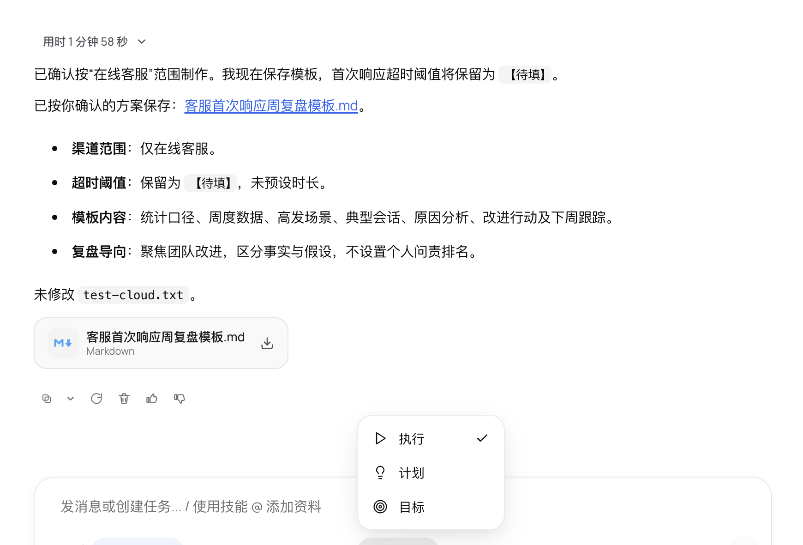

<p align="center"></p>
<h1 align="center">Bore Agent · 伯仁</h1>
<p align="center">在项目工作区里和智能体一起做事，从确认需求到交付文件。</p>

Bore Agent 是一个支持私有化部署的智能体工作台。你可以把业务需求发进对话，让伯仁读取项目资料、澄清口径、拟定计划，并在你确认后把结果写回工作区。每条对话都能回看执行过程和交付文件。

## 从一个真实任务开始

> 帮客服主管做一份每周复盘首次响应超时的 Markdown 模板。只剩渠道范围还没定，请先让我选渠道，再给我看方案，确认后保存。超时阈值保留为待填项。

**先确定统计范围。** 在「计划」模式里，伯仁询问模板应覆盖哪个渠道。主管可以选择“在线客服”，也可以输入自己的统计口径。


**再确认方案，拿到文件。** 批准后，对话切换到「执行」。伯仁把渠道、数据口径、原因分析和下周改进行动写进 Markdown 模板，阈值保留为待填项。主管可以从对话里的文件卡片打开或下载模板，下周直接复用。



## 选择工作方式

| 模式 | 适用场景 | 在对话中会发生什么 |
| --- | --- | --- |
| 执行 | 已经明确要做什么 | 读取资料、调用工具、编辑工作区文件并汇报结果。 |
| 计划 | 需求还有歧义，或希望先审方案 | 先进行只读调查，必要时询问用户。用户可以批准执行、提出修改意见或暂不执行。 |
| 目标 | 需要跨多步完成并验证一个结果 | 会话保存目标，智能体持续推进，并记录完成证据或需要用户处理的阻塞原因。 |

主智能体可将独立调查委派给只读子智能体，并在当前轮汇总结果。后台任务支持等待、查询和取消。长对话会按模型窗口预算压缩，保留近期工具调用和结果，并将较早的记录归档以供回读。

## 接入工作区

- **工具和技能**：通过工具注册表、项目 Skills 和可选的 MCP 服务扩展能力。
- **执行环境**：支持项目沙盒和本机连接器。连接器将选定目录作为智能体工作区。
- **会话与模型**：按项目管理会话和输出文件，配置模型连接、查看用量，也可以在会话中创建定时任务。

## 本地运行

准备 Bun、MongoDB 和可用的模型服务。附件上传与对象存储功能还需要 S3 兼容服务和相应的存储桶。

```bash
bun install --frozen-lockfile
cp .env.example .env
```

在 `.env` 中填写本地环境配置：

| 配置 | 用途 |
| --- | --- |
| `MONGODB_URI`、`JWT_SECRET` | 保存账号、项目和会话，并签发登录凭据。为自己的部署生成独立密钥。 |
| `AIPROXY_API_ENDPOINT`、`AIPROXY_API_TOKEN` | 通过 AIProxy 接入模型；直连兼容服务也可配置 `OPENAI_BASE_URL`、`CHAT_API_KEY`。 |
| `CHAT_MODEL_CONFIG_FILE` | 指向模型目录。检查模型 ID、连接地址和密钥环境变量，使其与自己的服务一致。 |
| `STORAGE_*` | 配置 S3 / MinIO 端点、桶和访问凭据。 |

```bash
bun run dev
```

打开 [本地工作台](http://localhost:3000)，登录后创建项目并开始对话。模型管理入口为 [模型工作台](http://localhost:3000/models)。完整配置见 [.env.example](.env.example) 和 [模型目录](config/config.json)。

### Docker Compose

在同一份 `.env` 中设置 `AGENT_SANDBOX_EXEC_TOKEN`，供 Web 与沙盒服务验证调用。MongoDB 和对象存储需要从容器网络可达。

```bash
docker compose up -d --build
```

默认 Web 入口为 [localhost:18367](http://localhost:18367)。服务和卷挂载见 [docker-compose.yml](docker-compose.yml)。

## 开发与测试

```bash
bun run typecheck
bun run test:agent
bun run build
```

| 目录 | 内容 |
| --- | --- |
| `src/agent/` | 会话运行、工具、子智能体委派、上下文压缩与沙盒适配 |
| `src/features/chat/` | 对话时间线、输入框、文件和交互卡片 |
| `src/pages/api/`、`src/server/` | API、身份验证、项目存储与模型接入 |
| `projects/` | 沙盒服务、本机连接器与设备端 |
| `skills/`、`data/project-templates/` | 内置技能与项目模板 |

进一步阅读：[智能体架构](docs/agent-architecture.md) · [上下文管理](docs/context-engineering.md)。

项目许可：Apache-2.0。
