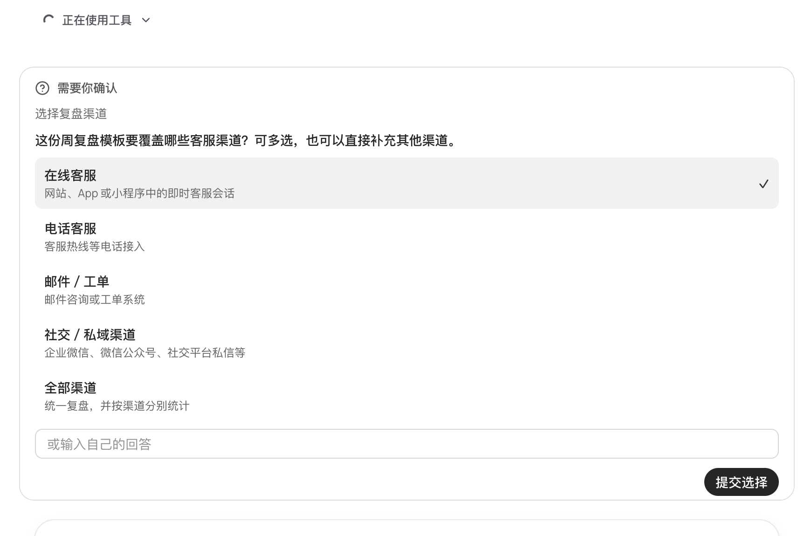

<p align="center"></p>
<h1 align="center">Bore Agent · 伯仁</h1>
<p align="center">在项目工作区里和智能体一起做事，从确认需求到交付文件。</p>

Bore Agent 是一个支持私有化部署的智能体工作台。你可以把业务需求发进对话，让伯仁读取项目资料、澄清口径、拟定计划，并在你确认后把结果写回工作区。每条对话都能回看执行过程和交付文件。

## 从一个真实任务开始

> 帮客服主管做一份每周复盘首次响应超时的 Markdown 模板。只剩渠道范围还没定，请先让我选渠道，再给我看方案，确认后保存。超时阈值保留为待填项。

**先确定统计范围。** 在「计划」模式里，伯仁询问模板应覆盖哪个渠道。主管可以选择“在线客服”，也可以输入自己的统计口径。



**再确认方案，拿到文件。** 批准后，对话切换到「执行」。伯仁把渠道、数据口径、原因分析和下周改进行动写进 Markdown 模板，阈值保留为待填项。主管可以从对话里的文件卡片打开或下载模板，下周直接复用。


## 选择工作方式

| 模式 | 适用场景 | 在对话中会发生什么 |
| --- | --- | --- |
| 执行 | 已经明确要做什么 | 读取资料、调用工具、编辑工作区文件并汇报结果。 |
| 计划 | 需求还有歧义，或希望先审方案 | 先进行只读调查，必要时询问用户。用户可以批准执行、提出修改意见或暂不执行。 |
| 目标 | 需要跨多步完成并验证一个结果 | 会话保存目标，智能体持续推进，并记录完成证据或需要用户处理的阻塞原因。 |

主智能体可将独立调查委派给只读子智能体，并在当前轮汇总结果。后台任务支持等待、查询和取消。长对话会按模型窗口预算压缩，保留近期工具调用和结果，并将较早的记录归档以供回读。

## Hermes Agent 规范与架构

Bore Agent 采用 **Hermes Agent** 的工具注册、插件贡献、技能渐进加载与 Gateway 编排规范（以 TypeScript 实现于 Next.js Node 服务端，非 Python 二进制兼容层）：

- **Gateway 编排（`src/agent/gateway/`）**：统一解析模型连接、建立沙盒与插件、冻结提示词上下文、驱动 ReAct 主循环并适配 SSE 流式协议，最终导出成果并释放资源。
- **Agent 主体（`src/agent/app/`）**：实现 ReAct 流式主循环、模型上下文窗口预算、工具输出裁剪与结构化摘要压缩（`docs/context-engineering.md`），以及跨轮持久化记忆（`src/agent/memory/`）。
- **工具与插件（`src/agent/tools/`、`src/agent/plugins/`）**：通过统一工具注册中心（`ToolRegistry`）分发内置工具，并支持通过插件 Manifest 贡献工具、技能、提示词与 MCP 服务，实现逐请求激活与逆序清理。
- **技能与 MCP（`src/agent/skills/`、`src/agent/mcp/`）**：支持 YAML frontmatter 技能的按需渐进加载（内置目录、项目快照与沙盒目录），以及基于 `@modelcontextprotocol/sdk` 的 stdio / HTTP / SSE MCP 客户端桥接。

```mermaid
flowchart LR
    User["用户浏览器 / 桌面端"] -->|HTTPS / SSE| Web["Agent 网关与前端页面 (bore-agent)"]
    Web -->|Gateway 编排| Agent["Hermes Agent (app / tools / plugins / skills)"]
    Agent -->|MCP / LLM API| LLM["模型服务 (AIProxy / OpenAI 兼容)"]
    Agent -->|remote-vm (HTTP Exec)| Sandbox["云主机沙盒 (agent-sandbox)"]
    Agent -->|WS/WSS 长连接 + 本机授权| Local["本地电脑客户端 (local-device)"]
    Agent -->|目录挂载| Connector["本机连接器 (agent-connector)"]
    Web -->|数据持久化| DB["MongoDB + S3 / MinIO"]
    Sandbox -.->|工作区快照同步| DB
```

## 项目组件说明

| 组件 / 目录 | 形态 | 职责说明 |
| --- | --- | --- |
| **Agent 网关与前端页面（`bore-agent`）** | Next.js 全栈服务（Node.js 24 + Bun） | 提供对话页面、模型管理、项目管理、Agent 网关 API 与 Hermes Agent 核心运行循环（`src/agent/`）。 |
| **远端沙盒（`agent-sandbox`）** | Docker 容器服务（`projects/agent-sandbox/`） | 基于容器与 HTTP Exec Server（`exec-server.ts`）提供隔离的命令执行与文件同步环境，支持工作区快照与 S3 持久化。 |
| **本地电脑客户端（`local-device`）** | Go 桌面托盘应用（`projects/local-device/`） | 支持 macOS / Windows，主动通过 WS/WSS 连接工作台，将个人电脑安全接入，每次执行需在本机弹窗授权并选择工作目录。 |
| **本机目录连接器（`agent-connector`）** | 轻量服务端（`projects/agent-connector/`） | 将本机指定目录直接挂载为智能体工作区。 |
| **外部基础依赖** | MongoDB + S3 / MinIO | MongoDB 存储账号、项目、会话与消息；S3 / MinIO 存储对话附件与沙盒工作区快照。 |

## 执行环境：云主机沙盒与本地电脑连接

工作区支持多种执行环境（`src/agent/sandbox/`），可根据安全隔离需求或本地协作场景灵活切换：

| 环境类型 | 对应模块 | 适用场景与特点 |
| --- | --- | --- |
| **云主机 / 远端沙盒（`remote-vm`）** | `projects/agent-sandbox/` | 基于 **Docker 容器 + HTTP Exec Server** 实现隔离执行（监听 `8080` 与 `8091/exec`），支持工作区快照同步（限制单文件 25MB、总大小 100MB、最多 5000 文件）与成果导出；可选开启 `AGENT_SANDBOX_S3_ENABLED` 将工作区同步至 S3/MinIO。 |
| **本地电脑连接（`local-device`）** | `projects/local-device/` | 提供原生桌面客户端（macOS / Windows 托盘应用），客户端主动建立 WS/WSS 长连接，**设备配对与执行授权分离**——每次会话执行均需在本机弹窗确认并选择工作目录。 |
| **本机目录连接器（`agent-connector`）** | `projects/agent-connector/` | 轻量级本机目录挂载连接器，将指定本地目录直接映射为智能体工作区。 |

> **编排技术与服务器配置建议**
> 当前远端沙盒采用 **Docker Compose 容器编排 + 独立 Exec Server**，无需部署 Kubernetes 或额外虚拟机管理程序。
> - **最低配置（个人开发 / 轻量试用）**：2 核 CPU、4 GB 内存、40 GB SSD（需同时运行 Web、沙盒、MongoDB 与 MinIO）。
> - **推荐配置（团队日常 / 多项目并发）**：4 核 CPU、8 GB+ 内存、80 GB+ SSD；若需高频并发执行代码构建或数据分析任务，建议 8 核 16 GB+。

- **会话与模型**：按项目管理会话和输出文件，配置模型连接、查看用量，也可以在会话中创建定时任务。

## 站点静态构建与托管

项目工作区中的前端代码可直接构建并发布为平台托管的静态站点，不依赖外部 Sandpack 服务或常驻后端进程：

- **构建机制（`src/server/shares/staticSiteBuilder.ts`）**：发布或访问站点时，服务端根据工作区文件自动识别纯静态 HTML 或 React / TypeScript / JavaScript 入口，使用 `esbuild` 打包静态资源并输出至 `data/published-sites/<shareId>/`；源码保存更新后会在访问或重新发布时自动增量重建。
- **静态托管与权限（`src/pages/api/sites/[shareId]/[[...assetPath]].ts`、`src/pages/share/preview/[shareId].tsx`）**：通过同源隔离 `iframe` 直接提供静态 HTML/JS/CSS 与静态资源，支持公开访问、受限成员校验与自定义短链（`/s/<slug>`）。
- **对话内管理（`src/server/library/sitePlugin.ts`）**：智能体可通过 `get_site_status`、`publish_site`、`unpublish_site` 工具在对话中直接查询静态构建与发布状态、发布/重建站点或取消发布并清理产物。

## 本地运行

准备 Node.js 24、Bun、MongoDB 和可用的模型服务。附件上传与对象存储功能还需要 S3 兼容服务和相应的存储桶。

```bash
nvm install
nvm use
bun install --frozen-lockfile
cp .env.example .env
```

在 `.env` 中填写 `MONGODB_URI`、`JWT_SECRET`、`STORAGE_*` 以及模型接入配置（见下方「模型配置」），然后启动开发服务器：

```bash
bun run dev
```

打开 [本地工作台](http://localhost:3000)，登录后创建项目并开始对话。模型管理入口为 [模型工作台](http://localhost:3000/models)。完整配置见 [.env.example](.env.example) 和 [模型目录](config/config.json)。

### Docker Compose 部署

[docker-compose.yml](docker-compose.yml) 默认编排了两个核心容器服务：
1. **`agent-sandbox`**：沙盒执行容器（映射宿主机 `18080:8080` 与 `18091:8091`），挂载 `./data/sandboxes:/workspace`。
2. **`bore-agent`**：Agent 网关与前端主服务（映射宿主机 `18367:3000`），依赖 `agent-sandbox`，挂载 `./config` 与 `./data/sandboxes`。

> **注意**：MongoDB 与 S3 / MinIO 需单独部署并确保从容器网络可达（若在宿主机运行，请使用宿主机内网 IP 或 `host.docker.internal`）。

启动前请在 `.env` 中确认以下组件配置：
- **基础与鉴权**：`MONGODB_URI`、`JWT_SECRET`、`AGENT_SANDBOX_EXEC_TOKEN`（Web 与沙盒容器间通信密钥，必填）。
- **对象存储（MinIO / S3）**：`STORAGE_S3_ENDPOINT`、`STORAGE_ACCESS_KEY_ID`、`STORAGE_SECRET_ACCESS_KEY`、`STORAGE_PUBLIC_BUCKET`、`STORAGE_PRIVATE_BUCKET`。
- **模型接入**：按下方「模型配置」填写对应环境变量或挂载 `config/config.json`。

```bash
docker compose up -d --build
```

启动后访问 [localhost:18367](http://localhost:18367)。

## 模型配置

支持三种模型接入方式（可在 `.env` 中配置，或在运行时通过 [模型工作台](http://localhost:3000/models) 管理）：

1. **AIProxy 接入（优先）**：在 `.env` 中配置 `AIPROXY_API_ENDPOINT` 与 `AIPROXY_API_TOKEN`。
2. **直连 OpenAI 兼容接口**：在 `.env` 中配置 `OPENAI_BASE_URL` 与 `CHAT_API_KEY`。
3. **模型目录文件（`config/config.json`）**：通过 `CHAT_MODEL_CONFIG_FILE=config/config.json` 指定，在 `model` 数组中声明模型：
   - `id` / `label`：模型 ID 与界面显示名称
   - `protocol`：协议类型（如 `openai`）
   - `baseUrl`：模型服务地址
   - `keyEnv`：对应的 API Key 环境变量名（如 `GPT_61_SOL_API_KEY`，需在 `.env` 中赋值）
   - `toolChoiceMode`：工具调用模式（如 `auto`）

## 开发与测试

```bash
bun run typecheck
bun run test:agent
bun run build
```

| 目录 | 内容 |
| --- | --- |
| `src/agent/` | 会话运行、工具、子智能体委派、上下文压缩与沙盒适配 |
| `src/features/chat/` | 对话时间线、输入框、文件和交互卡片 |
| `src/pages/api/`、`src/server/` | API、身份验证、项目存储与模型接入 |
| `projects/` | 沙盒服务、本机连接器与设备端 |
| `skills/` | 内置技能目录 |

进一步阅读：[智能体架构](docs/agent-architecture.md) · [上下文管理](docs/context-engineering.md) · [本地电脑连接器指南](projects/local-device/HANDBOOK.md)。

项目许可：Apache-2.0。
